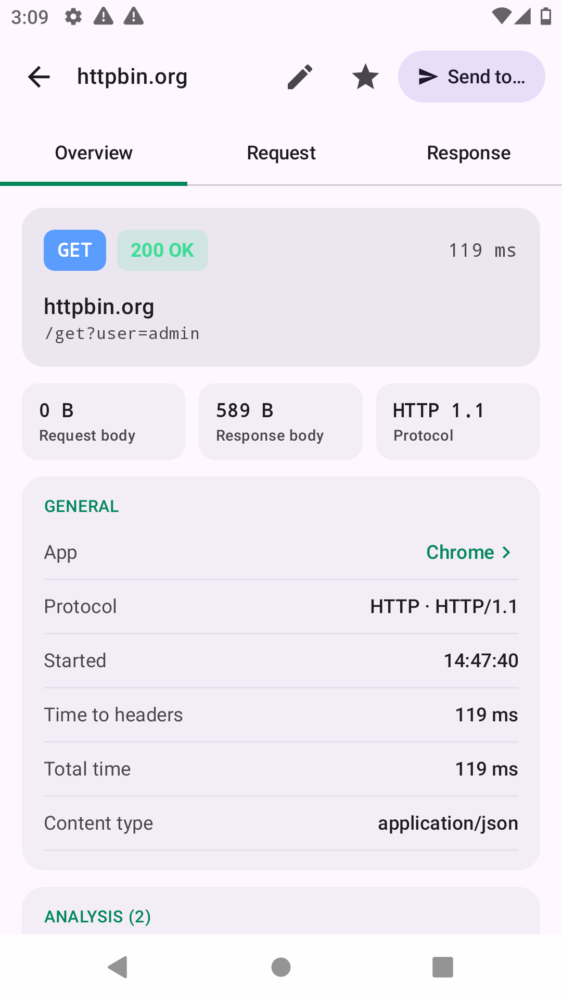
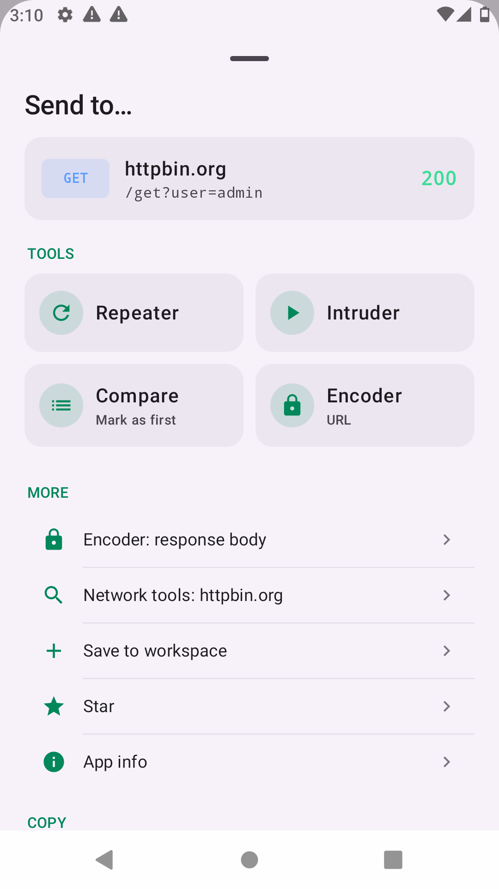
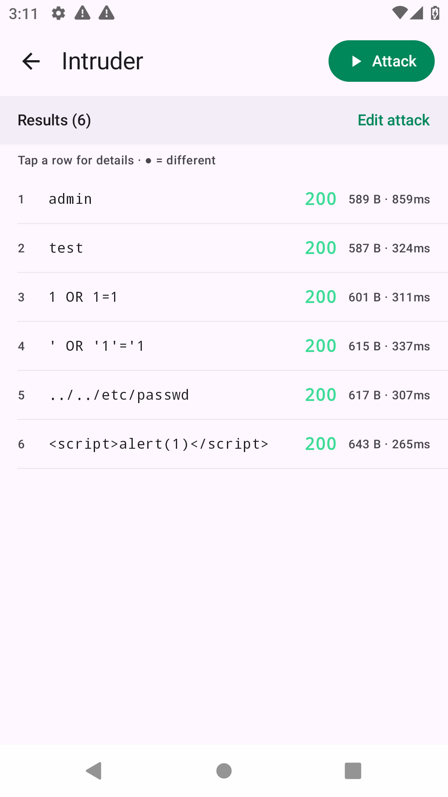
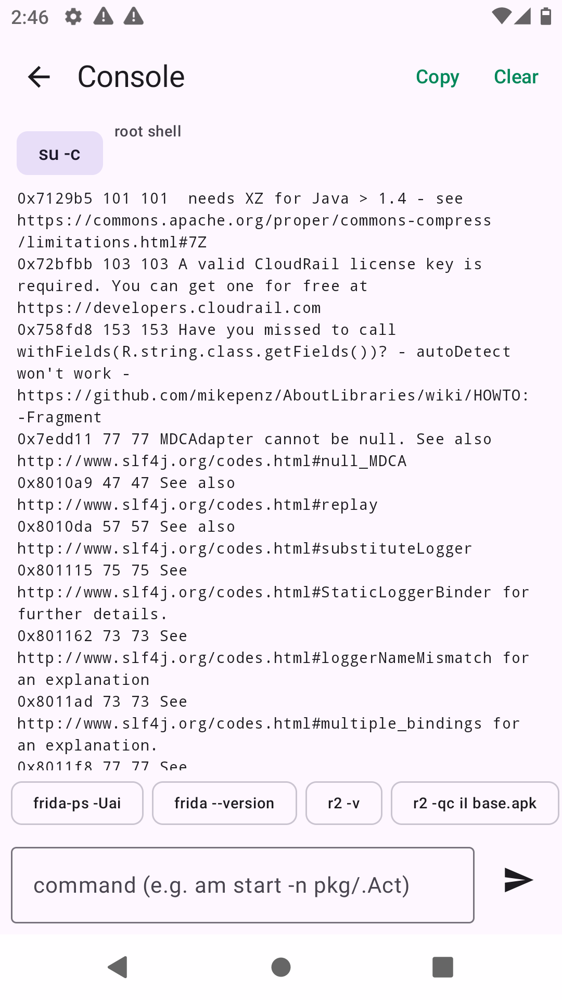

# La pipelette

**A mobile pentest toolkit that runs on the phone itself.** Capture and decrypt app traffic, replay and fuzz requests, bypass SSL pinning with one tap, and reverse-engineer APKs — no laptop, no proxy setup, no cables.

  
  
  
  

> ⚠️ **For authorized testing only.** Use La pipelette on devices you own and on apps you are allowed to test (your own apps, a bug bounty scope, a signed pentest engagement). You are responsible for how you use it.

---

## Features

| | |
|---|---|
| **Traffic capture** | Every app's traffic goes through a local VPN. See each request, response, connection, DNS query and the app it belongs to. |
| **HTTPS decryption** | A certificate authority is generated on your device. HTTPS traffic of apps that trust it is decrypted and shown. With root, an "SSL kill-switch" decrypts traffic from every app. |
| **SSL pinning bypass** | One tap: pick an app → it restarts with Frida and the pinning bypass already loaded. Frida is installed automatically for your CPU. |
| **Repeater** | Edit any request (method, URL, headers, body) and send it again. Paste a cURL command to start from it. |
| **Intruder** | Select part of a request, mark it as the payload position, load a list, attack. Every result opens with its full request and response; unusual responses are highlighted. |
| **Send to…** | Like Burp: from any request, send it to Repeater, Intruder, Compare, Encoder, Network tools or your workspace, or copy it as URL / cURL / raw. |
| **Compare** | Side-by-side diff of two requests and their responses. |
| **Encoder** | URL, Base64, hex, HTML, JWT decode and more. |
| **Security hints** | Each request is scanned for secrets, tokens, JWTs, CORS mistakes, reflected parameters and missing security headers. |
| **APK decompiler** | Decompile any installed app to Java source on the device (jadx). Browse files, jump to activities, deep links and WebViews. |
| **radare2** | Analyse an app's code (classes, strings, URLs, secrets, native libraries) with one tap. Installed automatically for your CPU. |
| **Console & Logcat** | Root shell with r2 / Frida on the PATH, and a filtered, per-app Logcat. |
| **Upstream proxy** | Forward everything to Burp or another proxy (HTTP CONNECT or SOCKS5). |
| **Export / Import** | HAR, cURL scripts, PCAP for Wireshark, and more. |
| **Languages** | English, Türkçe, Français. |

## Requirements

- Android **10 or newer** (arm64, arm or x86_64)
- **Root is optional.** Without root you get capture, decryption for apps that trust user certificates, Repeater, Intruder, Compare, Encoder and the decompiler. With root you also get: decryption for every app, Frida pinning bypass, radare2, full Logcat and the root console.

## Install

1. Download [`La-pipelette.apk`](https://github.com/HCIBO/LaPipelette/releases/download/v1.0.0/La-pipelette.apk).
2. (Optional) Verify it: the output of `sha256sum La-pipelette.apk` must match [`La-pipelette.apk.sha256`](https://github.com/HCIBO/LaPipelette/releases/download/v1.0.0/La-pipelette.apk.sha256).
3. Open the APK on your phone and allow "Install unknown apps" when Android asks.
4. Open La pipelette → tap **Start** → accept the VPN prompt, then use any app.

The in-app **Help** screen explains every feature, in English, Turkish and French.

## Contact

Questions, feedback or collaboration: [LinkedIn](https://www.linkedin.com/in/ciboh/)
